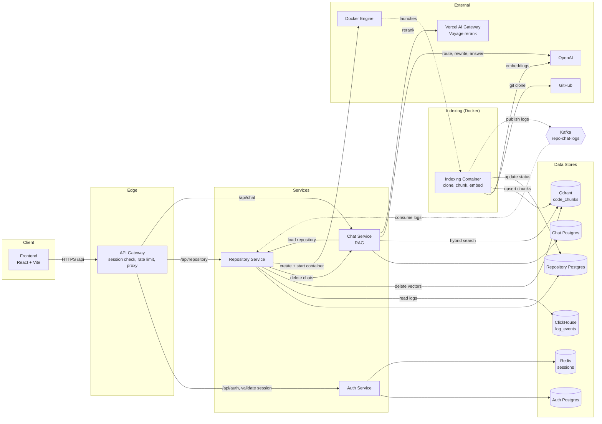

# Repo Chat

Repo Chat lets you ask natural-language questions about a public GitHub repository and get answers grounded in its source code. You add a repository by URL. Repo Chat clones it, splits the code into syntax-aware chunks, and stores embeddings in a vector database. Chat answers then cite the files and line ranges they used.

It is intended for developers who need to understand an unfamiliar codebase quickly, for example during onboarding, code review, or when evaluating a dependency.

## Contents

- [Overview](#overview)
- [Features](#features)
- [Architecture](#architecture)
- [Tech stack](#tech-stack)
- [Prerequisites](#prerequisites)
- [Local setup](#local-setup)
- [Self-hosting (all-in-one Docker image)](#self-hosting-all-in-one-docker-image)
- [Environment variables](#environment-variables)
- [Usage](#usage)
- [API](#api)
- [Project structure](#project-structure)
- [Quality checks](#quality-checks)
- [Deployment notes](#deployment-notes)
- [Limitations](#limitations)
- [Contributing](#contributing)
- [License](#license)

## Overview

Reading an unfamiliar repository usually means grepping for names you don't know yet. General-purpose chat models can't help much because they haven't seen the code, or they answer from stale training data.

Repo Chat indexes the actual code and runs retrieval-augmented generation (RAG) over it:

1. **Indexing.** An isolated container clones the repository and parses every supported source file with tree-sitter. It chunks the code along syntax boundaries, embeds each chunk with OpenAI `text-embedding-3-small`, and stores the vectors in Qdrant. Each chunk is tagged with its repository and user.
2. **Answering.** For each question, a small model routes the query to one of four strategies: search as written, rewrite it into a standalone query, generate a hypothetical code snippet (HyDE), or decline it as off-topic. Dense vector search and BM25 keyword search run in parallel. A reranker narrows the combined results to the 8 most relevant chunks, and the answer streams back with those chunks as context.

## Features

- **Accounts:** sign up and sign in with email and password. Sessions are stored in Redis and last 7 days.
- **Add repositories:** paste a public GitHub URL. Name, description, star count, and primary language are fetched from the GitHub API.
- **Track indexing:** each repository moves through `QUEUED → INDEXING → INDEXED` (or `FAILED`), and the UI polls for status changes. Re-queueing a repository re-runs indexing from scratch.
- **Live indexing logs:** a per-repository log view shows indexer progress, for example "stored 640 chunks from 112 files".
- **Chat with a repository:** responses stream as they are generated, with status updates (analyzing → searching → reranking → generating) and a list of the source files and line ranges used.
- **Chat history:** chats are grouped per repository and paginated, and you can rename them or delete them one at a time. The first message automatically gets a title.
- **Off-topic guard:** the chat declines questions that aren't about the selected repository instead of answering from general knowledge.
- **Cleanup:** deleting a repository also deletes its vectors, indexing logs, and chats.

## Architecture



| Component | Responsibility |
|---|---|
| `frontend` | React SPA for authentication, repository management, indexing logs, and chat. Talks only to the gateway. |
| `api-gateway` | Single public entry point. Applies rate limiting and CORS. Validates the session cookie against `auth-service` and forwards `x-user-id`, `x-user-email`, and `x-request-id` headers to downstream services. |
| `auth-service` | Registration, login, and logout. Stores users in Postgres (bcrypt-hashed passwords) and sessions in Redis. |
| `repository-service` | Repository CRUD. Starts a Docker indexing container for each new or re-queued repository. Consumes indexing logs from Kafka into ClickHouse and serves them to the UI. |
| `indexing-service` | Short-lived container, one run per repository. Clones the repository, chunks and embeds it, writes vectors to Qdrant, updates repository status in the repository database, and publishes progress logs to Kafka. |
| `chat-service` | Stores chats and messages. Runs the RAG pipeline (routing, query transformation, hybrid search, reranking) and streams answers with the Vercel AI SDK UI message protocol. |

Key design decisions:

- **Session auth at the edge.** Downstream services don't parse cookies. They trust the `x-user-id` header set by the gateway, so they must not be reachable from the public internet.
- **Indexing runs out of process.** Cloning and embedding a large repository is slow and resource-heavy, so `repository-service` starts a separate Docker container for each repository instead of indexing in its own process.
- **Shared repository table.** `indexing-service` writes repository status directly to `repository-service`'s Postgres database. It has its own copy of the Prisma schema but no migrations, so `repository-service` owns the schema.
- **Hybrid retrieval with fallbacks.** If the query router fails, the question is searched as written. If one search method fails, the other's results are used. If the reranker fails, results are combined with reciprocal rank fusion instead.

Each HTTP service also serves an OpenAPI spec at `/docs.json` and Swagger UI at `/docs`.

## Tech stack

| Area | Technologies |
|---|---|
| Monorepo | pnpm workspaces, Turborepo, TypeScript, tsup |
| Frontend | React 19, Vite, React Router 7, TanStack Query, React Hook Form + Zod, Tailwind CSS 4, shadcn/ui, Streamdown + Shiki for Markdown and code highlighting |
| Backend | Node.js 24+, Express 5, Zod, `@t3-oss/env-core` for validated config, pino logging, Helmet, `http-proxy-middleware` |
| Data | PostgreSQL 16 with Prisma 7 (one database per service), Redis 7 for sessions, ClickHouse for indexing logs |
| Messaging | Kafka (kafkajs) for streaming logs from the indexer to `repository-service` |
| AI and search | Vercel AI SDK, OpenAI chat and embedding models, Vercel AI Gateway for reranking (`voyage/rerank-3-lite` by default), Qdrant, chonkie + tree-sitter for code chunking |
| Infrastructure | Docker Compose for local dependencies, Docker Engine (via dockerode) for indexing containers |

## Prerequisites

| Requirement | Notes |
|---|---|
| Node.js `>= 24` | Required by the root `package.json`. The indexer image installs Node 24. |
| pnpm `11.25.0` | Pinned via `packageManager`. Run `corepack enable` to use it. |
| Docker with Docker Compose | Runs Postgres, Redis, and ClickHouse locally. |
| Kafka cluster with **TLS and SASL/PLAIN** | Both Kafka clients always connect over TLS with a CA file named `ca.pem`. See [Limitations](#limitations). |
| Qdrant | Qdrant Cloud or a self-hosted instance with an API key. |
| OpenAI API key | Used for chat, titles, query routing and rewriting, and embeddings. |
| Vercel AI Gateway API key | Used for reranking. |
| Docker Engine | `repository-service` launches the indexer image as a container through the Docker socket, so the daemon must be reachable and the indexer image available to it. |

## Local setup

All commands below run from the repository root unless a step says otherwise.

### 1. Clone and install

```bash
git clone https://github.com/nilavtalukdar06/repo-chat.git
cd repo-chat
corepack enable
pnpm install
```

### 2. Start local infrastructure

Each service with stateful dependencies has its own `docker-compose.yml`. Both `auth-service` and `repository-service` publish Postgres on port `5432` by default, so give the second one a different port:

```bash
docker compose -f apps/auth-service/docker-compose.yml up -d        # Postgres :5432, Redis :6379
docker compose -f apps/chat-service/docker-compose.yml up -d        # Postgres :5433
POSTGRES_PORT=5434 docker compose -f apps/repository-service/docker-compose.yml up -d postgres clickhouse
```

The `repository-service` Compose file also defines a plaintext Kafka container. To use it locally, set `KAFKA_SSL=false` and `KAFKA_SASL=false` for `repository-service` and `indexing-service`; otherwise the clients default to TLS + SASL and expect a `ca.pem`.

Default credentials for each Compose database are the service name for the user, password, and database name, for example `auth_service:auth_service@localhost:5432/auth_service`.

### 3. ClickHouse table

No manual step is needed: `repository-service` creates the `log_events` table idempotently on
startup (`ensureLogTable()` in `src/logs/clickhouse.ts`). Just make sure the `repository_service`
database exists in ClickHouse (the Compose file creates it via `CLICKHOUSE_DB`).

### 4. Configure environment variables

Create a `.env` file in each app directory using the tables in [Environment variables](#environment-variables):

```bash
cp apps/frontend/.env.example apps/frontend/.env
touch apps/api-gateway/.env apps/auth-service/.env apps/repository-service/.env apps/chat-service/.env
```

Put your Kafka CA certificate at `apps/repository-service/ca.pem`. The indexer image also needs it at `apps/indexing-service/ca.pem`. Both files are gitignored.

### 5. Generate Prisma clients and run migrations

The Prisma config files are named `prisma7.config.ts`, so pass `--config` explicitly:

```bash
for svc in auth-service repository-service chat-service; do
  pnpm --filter "$svc" exec prisma generate --config prisma7.config.ts
  pnpm --filter "$svc" exec prisma migrate deploy --config prisma7.config.ts
done
```

### 6. Start the application

```bash
pnpm dev
```

This starts the frontend, gateway, and the auth, repository, and chat services in watch mode. `indexing-service` is excluded because it runs as a Docker container per repository, not a long-running server.

| Service | URL |
|---|---|
| Frontend | http://localhost:5173 |
| API gateway | http://localhost:3000 |
| auth-service | http://localhost:4000 |
| repository-service | http://localhost:4001 |
| chat-service | http://localhost:4002 |

### 7. Verify

```bash
curl http://localhost:3000/health
```

A healthy stack returns `200` with `authService`, `repositoryService`, and `chatService` all `true`. Each service's own `/health` endpoint reports its dependencies (Postgres, Redis, Kafka, and ClickHouse, depending on the service).

Then open http://localhost:5173, create an account, and add a repository.

## Self-hosting (all-in-one Docker image)

For self-hosting, the entire stack — all four Node services, the static frontend, **and** every
dependency (PostgreSQL, Redis, ClickHouse, Kafka, Qdrant) — is packaged into a single Docker image.
You pull one image, pass your API keys, and run one container. No external services are required.

### Run

```bash
docker run -d --privileged \
  -p 3000:3000 \
  -e OPENAI_API_KEY=sk-... \
  -e AI_GATEWAY_API_KEY=... \
  -e PUBLIC_URL=http://localhost:3000 \
  -v repo-chat-data:/data \
  <dockerhub-user>/repo-chat:latest
```

Then open http://localhost:3000, create an account, and add a repository. The frontend and the API
are served from the same origin (the gateway on port 3000).

`--privileged` is required: the container runs its own Docker daemon (Docker-in-Docker) and launches
each repository's indexing job as a sibling container, exactly as in the cloud deployment.

### Build locally

```bash
docker build -t repo-chat .
```

The image is deliberately heavy (around 7 GB) — it bundles a JVM (for Kafka), ClickHouse, a full
Docker daemon, and a pre-built copy of the indexer image. Everything that can be prepared at build
time is: the indexer image is built once here and baked in as a loadable tarball, and the three
Postgres databases (migrated) plus the ClickHouse log table are pre-seeded. None of that happens
at container startup anymore — a fresh container has a usable database and a ready-to-load indexer
image the moment it starts.

### Required / notable environment variables

| Variable | Required | Default | Description |
|---|---|---|---|
| `OPENAI_API_KEY` | Yes | | Used for chat, titles, query routing/rewriting, and embeddings. |
| `AI_GATEWAY_API_KEY` | Yes | | Vercel AI Gateway key, used for reranking. |
| `PUBLIC_URL` | No | `http://localhost:3000` | The origin the app is served from. Used for CORS. Set this to your real URL when exposing the app. |
| `SESSION_SECRET` | No | auto-generated | A random secret is generated on first boot and persisted to the `/data` volume if you don't supply one. |

### What happens on startup (bootstrapping)

Most of the bootstrapping work now happens once, at `docker build` time, not on every container
start — see [Build locally](#build-locally). What's left at startup is fast:

1. Starts PostgreSQL, Redis, ClickHouse, Kafka, Qdrant, and the Docker daemon (needed for
   Docker-in-Docker indexing containers).
2. On a **fresh** named volume, Docker has already copied in the pre-seeded Postgres data (role,
   three databases, migrations applied) and ClickHouse data (`log_events` table created) that were
   baked into the image — nothing to create here. (An existing volume from a previous run is left
   untouched; `repository-service` also re-checks the role/databases/migrations defensively on every
   boot, in case a future image version ships new migrations against an older volume.)
3. Loads the pre-built indexer image (`docker import`, a filesystem import — no compiling, no
   network calls) and starts the four Node services. `repository-service` specifically waits until
   the indexer image is loaded before accepting traffic, since it's the one that launches indexing
   containers; the other three services (including the gateway) start as soon as the databases are
   ready. The gateway serves the static frontend and proxies `/api`.

A fresh container is typically fully ready — including the ability to add and index a repository —
within 20–30 seconds.

### Data persistence

All state lives under `/data` (Postgres, ClickHouse, Kafka, Qdrant, Redis, the Docker-in-Docker
storage, and the generated session secret). Mount a named volume (`-v repo-chat-data:/data`) to
keep your data across restarts.

### Serving over HTTPS

The bundled config sets `SESSION_COOKIE_SECURE=false` so login works over plain HTTP on localhost.
If you put the container behind an HTTPS reverse proxy, set `PUBLIC_URL` to your `https://` origin
and override `SESSION_COOKIE_SECURE=true`.

## Environment variables

Each app reads its own `.env` file, which is loaded by `dotenv` and validated with Zod at startup. A service won't start if a required variable is missing.

### `apps/frontend`

| Variable | Required | Default | Description |
|---|---|---|---|
| `VITE_API_URL` | No | `http://localhost:3000` | Base URL of the API gateway. |

### `apps/api-gateway`

| Variable | Required | Default | Description |
|---|---|---|---|
| `PORT` | No | `4002` | **Set to `3000`.** The default conflicts with `chat-service`, and the frontend expects the gateway on `3000`. |
| `CLIENT_URL` | Yes | | Allowed CORS origins, comma-separated, for example `http://localhost:5173`. |
| `NODE_ENV` | No | `development` | `development` or `production`. |
| `RATE_LIMIT_WINDOW_MS` | No | `60000` | Rate-limit window in milliseconds. |
| `RATE_LIMIT_MAX_REQUESTS` | No | `1000` | Maximum requests per client per window. |
| `AUTH_SERVICE_URL` | Yes | | For example `http://localhost:4000`. |
| `REPOSITORY_SERVICE_URL` | Yes | | For example `http://localhost:4001`. |
| `CHAT_SERVICE_URL` | Yes | | For example `http://localhost:4002`. |
| `SERVICE_REQUEST_TIMEOUT_MS` | No | `5000` | Timeout for session validation and health checks. |
| `FRONTEND_DIR` | No | | When set, the gateway serves the built frontend from this directory and falls back to `index.html` for client-side routes (used by the self-hosted image). Also disables the HTTPS-upgrade CSP so the SPA works over plain HTTP. |

### `apps/auth-service`

| Variable | Required | Default | Description |
|---|---|---|---|
| `PORT` | No | `4000` | |
| `CLIENT_URL` | Yes | | Allowed CORS origin(s). |
| `NODE_ENV` | No | `development` | Session cookies default to `Secure` only in `production`. |
| `BODY_LIMIT` | No | `10kb` | Maximum request body size. |
| `DATABASE_URL` | Yes | | Postgres connection string. |
| `REDIS_URL` | Yes | | For example `redis://localhost:6379`. |
| `SESSION_SECRET` | Yes | | At least 32 characters. Generate one with `openssl rand -hex 32`. |
| `SESSION_COOKIE_SECURE` | No | follows `NODE_ENV` | `true` or `false`. Overrides the cookie `Secure` flag. Set `false` to serve over plain HTTP (e.g. self-hosting on localhost). |

### `apps/repository-service`

| Variable | Required | Default | Description |
|---|---|---|---|
| `PORT` | No | `4001` | |
| `CLIENT_URL` | Yes | | Allowed CORS origin(s). |
| `NODE_ENV` | No | `development` | |
| `BODY_LIMIT` | No | `10kb` | |
| `DATABASE_URL` | Yes | | Postgres connection string. The indexer must also be able to reach this database. |
| `DOCKER_SOCKET_PATH` | No | `/var/run/docker.sock` | Path to the Docker daemon socket used to launch indexing containers. |
| `INDEXING_IMAGE` | Yes | | Image tag of the indexer (built from `apps/indexing-service`) to run per repository. Must be available to the Docker daemon. |
| `INDEXING_NETWORK_MODE` | No | | Docker network mode for the indexer container (e.g. `host`). Used by the self-hosted image so the sibling container reaches the bundled infra on `localhost`. |
| `CLICKHOUSE_URL` | Yes | | Include the database in the path, for example `http://localhost:8123/repository_service`. |
| `CLICKHOUSE_ADMIN` | Yes | | ClickHouse username. |
| `CLICKHOUSE_PASSWORD` | Yes | | |
| `KAFKA_BROKER` | Yes | | `host:port` of the broker. |
| `KAFKA_SSL` | No | `true` | `true`/`false`. When `true`, connects over TLS using a `ca.pem` file. Set `false` for a plaintext broker. |
| `KAFKA_SASL` | No | `true` | `true`/`false`. When `true`, authenticates with SASL/PLAIN. Set `false` for a broker without auth. |
| `KAFKA_USERNAME` | When `KAFKA_SASL=true` | | |
| `KAFKA_PASSWORD` | When `KAFKA_SASL=true` | | |
| `QDRANT_URL` | Yes | | Used to delete vectors when a repository is deleted. |
| `QDRANT_API_KEY` | No | | Omit for a self-hosted Qdrant without an API key. |
| `OPENAI_API_KEY` | Yes | | Not used by `repository-service` itself — forwarded to each indexing container at launch (see `apps/indexing-service` below). |
| `CHAT_SERVICE_URL` | Yes | | Used to delete chats when a repository is deleted. |
| `SERVICE_REQUEST_TIMEOUT_MS` | No | `5000` | |

### `apps/chat-service`

| Variable | Required | Default | Description |
|---|---|---|---|
| `PORT` | No | `4002` | |
| `CLIENT_URL` | Yes | | Allowed CORS origin(s). |
| `NODE_ENV` | No | `development` | |
| `BODY_LIMIT` | No | `10kb` | |
| `DATABASE_URL` | Yes | | Postgres connection string. |
| `OPENAI_API_KEY` | Yes | | |
| `OPENAI_MODEL` | No | `gpt-4o-mini` | Model that writes answers. |
| `OPENAI_TITLE_MODEL` | No | `gpt-4o-mini` | Model that generates chat titles. |
| `QUERY_ROUTER_MODEL` | No | `gpt-4.1-nano` | Model that picks the retrieval strategy. |
| `QUERY_REWRITE_MODEL` | No | `gpt-4o-mini` | Model that rewrites queries and writes HyDE snippets. |
| `AI_GATEWAY_API_KEY` | Yes | | Vercel AI Gateway key, used for reranking. |
| `AI_GATEWAY_BASE_URL` | No | | Override the AI Gateway endpoint. |
| `RERANK_MODEL` | No | `voyage/rerank-3-lite` | Reranking model, accessed through the AI Gateway. |
| `QDRANT_URL` | Yes | | |
| `QDRANT_API_KEY` | No | | Omit for a self-hosted Qdrant without an API key. |
| `QDRANT_COLLECTION` | No | `code_chunks` | Must match the collection the indexer writes to, which is hard-coded as `code_chunks`. |
| `REPOSITORY_SERVICE_URL` | Yes | | Used to check that a repository is owned by the user and fully indexed. |
| `SERVICE_REQUEST_TIMEOUT_MS` | No | `5000` | |

### `apps/indexing-service`

`repository-service` passes every one of these as container environment variables on each run —
`DATABASE_URL`, `KAFKA_*`, `QDRANT_*`, and `OPENAI_API_KEY` come from `repository-service`'s own
config, matching it exactly; `GIT_URL`, `REPOSITORY_ID`, and `USER_ID` are per-run values. Nothing
below needs to be correct in the image's own baked `.env` (the `Dockerfile` still copies one, but
only to satisfy startup validation before the real values arrive) — rotating any of these values
is just a case of restarting `repository-service` with the new value, no indexer rebuild needed.

| Variable | Required | Default | Description |
|---|---|---|---|
| `NODE_ENV` | No | `development` | |
| `DATABASE_URL` | Yes | | **`repository-service`'s** Postgres database. |
| `KAFKA_BROKER` | Yes | | Same broker as `repository-service`. |
| `KAFKA_SSL` / `KAFKA_SASL` | No | `true` | `true`/`false`, as in `repository-service`. Set `false` for a plaintext broker without auth. |
| `KAFKA_USERNAME` / `KAFKA_PASSWORD` | When `KAFKA_SASL=true` | | |
| `QDRANT_URL` | Yes | | |
| `QDRANT_API_KEY` | No | | Omit for a self-hosted Qdrant without an API key. |
| `OPENAI_API_KEY` | Yes | | Used for embeddings. |
| `OUTPUT_DIR` | No | `/home/app/output` | Clone destination. `main.sh` always clones to `/home/app/output`. |
| `GIT_URL` | Set per run | | Repository to clone. |
| `REPOSITORY_ID` | Set per run | | |
| `USER_ID` | Set per run | | |

## Usage

1. **Sign up** at `/signup`, or sign in at `/signin`.
2. **Add a repository** on the Repositories page by pasting a URL such as `https://github.com/expressjs/express`. The card shows `QUEUED`, then `INDEXING`, then `INDEXED`.
3. **Watch progress** under the repository's logs view (`/repositories/:id/logs`).
4. **Start a chat** from the home page: pick an indexed repository and ask a question, for example:
   - "How is session validation handled between the gateway and auth service?"
   - "Where are retries configured for vector upserts?"
   - "What does `extractTerms` do?"
5. Each answer shows the source chunks it used. Use the sidebar to revisit, rename, or delete chats.

## API

All client traffic goes through the gateway. Every route except register, login, health, and docs requires a valid `connect.sid` session cookie. Responses use this envelope:

```json
{ "success": true, "statusCode": 200, "message": "…", "data": {}, "meta": {} }
```

| Method | Path | Description |
|---|---|---|
| `POST` | `/api/auth/register` | Body: `{ name, email, password }`. The password must be at least 8 characters. |
| `POST` | `/api/auth/login` | Body: `{ email, password }`. Sets the session cookie. |
| `POST` | `/api/auth/logout` | Destroys the session. |
| `GET` | `/api/auth/me` | Returns the current user. |
| `POST` | `/api/repository` | Body: `{ githubUrl }`. Creates the repository and starts indexing. |
| `GET` | `/api/repository?page=&limit=&search=` | Paginated list. `limit` is at most 100. |
| `GET` | `/api/repository/:id` | Gets one repository. |
| `GET` | `/api/repository/:id/logs` | Indexing logs from ClickHouse. |
| `PATCH` | `/api/repository/:id` | Body: `{ status }`. Setting `QUEUED` re-runs indexing. |
| `DELETE` | `/api/repository/:id` | Deletes the repository with its vectors, logs, and chats. Returns `409` while queued or indexing. |
| `GET` | `/api/chat?repositoryId=&limit=&cursor=` | Cursor-paginated chats for a repository. `limit` is at most 50. |
| `GET` | `/api/chat/:id` | Gets a chat with its messages. |
| `PATCH` | `/api/chat/:id` | Body: `{ title }`. Renames the chat. |
| `DELETE` | `/api/chat/:id` | Deletes one chat. |
| `DELETE` | `/api/chat?repositoryId=` | Deletes all of the user's chats for a repository. |
| `POST` | `/api/chat/:id/messages` | Body: `{ repositoryId, message: { parts: [{ type: "text", text }] } }`. Text is at most 4000 characters. Streams an AI SDK UI message stream. The chat is created on the first message if the client-generated `:id` is new. Returns `409` if the repository isn't indexed. |

For full request and response schemas, open `/docs` on the gateway or on any individual service.

## Project structure

```text
apps/
  frontend/             React SPA
    src/features/       auth, chats, repositories: API calls, queries, hooks, components
    src/routes/         route components (lazy-loaded)
  api-gateway/          public edge: proxy, session check, rate limiting, aggregate health
  auth-service/         users and sessions
  repository-service/   repositories, Docker container launch, Kafka → ClickHouse log pipeline
    src/logs/           Kafka consumer, ClickHouse client, table DDL
  chat-service/         chats, messages, RAG pipeline
    src/services/       rag, query-router, query-transform, retrieval, title
    src/constants/      prompts
  indexing-service/     Docker container: clone, chunk, embed, store
    src/indexer/        files → chunk → embed → store
packages/
  eslint-config/        shared ESLint configs
  typescript-config/    shared tsconfig bases
  ui/                   Turborepo starter components (not currently used by any app)
```

The backend services follow the same layering: `routes → controllers → services → repositories`, with Zod validators, a shared `ApiError` and response helper, request-ID middleware, and a Prisma client generated into `src/generated/prisma` (gitignored).

## Quality checks

Run these from the repository root. Turborepo runs them in every workspace that defines the script.

```bash
pnpm lint          # ESLint
pnpm check-types   # tsc --noEmit (backend services and packages/ui)
pnpm build         # tsup for services; tsc -b && vite build for the frontend
pnpm format        # Prettier for .ts, .tsx, and .md
```

The repository has no automated test suite yet.

## Deployment notes

There are no deployment manifests in the repository apart from the indexer `Dockerfile`. To run the stack in production:

- **Build** with `pnpm build` and start each service with `pnpm --filter <service> start` (`node dist/index.js`). The frontend builds to `apps/frontend/dist` as static files.
- **Migrate** each database with `prisma migrate deploy --config prisma7.config.ts` before starting the new version.
- **Expose only the gateway** (and the frontend's static host). The internal services trust the `x-user-id` header and must stay on a private network.
- **Set `NODE_ENV=production`** so session cookies are marked `Secure`. The frontend and gateway must be on the same site, because the session cookie is `SameSite=Lax`.
- **Indexer image.** Build it from `apps/indexing-service`, with `.env` and `ca.pem` present in that directory, and make it available to the Docker daemon that `repository-service` talks to. Set `repository-service`'s `INDEXING_IMAGE` to the resulting tag:

  ```bash
  cd apps/indexing-service
  docker build -t repo-chat-indexer .
  ```

  `repository-service` overrides `DATABASE_URL`, `KAFKA_*`, `QDRANT_*`, and `OPENAI_API_KEY` as container environment variables on every run, so the baked `.env`'s values for those don't need to be real — they only need to exist so the indexer's own startup validation passes before the real ones arrive. `ca.pem` is the one thing that still has to be baked for real (Kafka's TLS CA cert is a file, not an env var) if `KAFKA_SSL=true`. Push the image only to a private registry regardless, since it still contains that cert.
- **Health checks.** Every service exposes `GET /health`, which checks its dependencies and returns `503` when degraded, and `GET /ready`, a liveness check that always returns `200`.

## Limitations

- **Public GitHub repositories only.** Metadata comes from the unauthenticated GitHub API, which allows 60 requests per hour per IP, and the indexer clones without credentials.
- **Snapshot indexing.** Only the default branch is indexed, as a shallow clone. Changes pushed later aren't picked up until you re-queue the repository.
- **File filtering.** Files larger than 512 KB, binary files, lockfiles, minified or generated files, `.env*` files, and key or certificate files are skipped, as are paths ignored by the repository's `.gitignore`. Only languages supported by the tree-sitter language pack are indexed.
- **Kafka security is configurable.** Both Kafka clients default to TLS (`ca.pem`) with SASL/PLAIN, but setting `KAFKA_SSL=false` and `KAFKA_SASL=false` lets them talk to a plaintext broker such as the container in `apps/repository-service/docker-compose.yml` (this is what the self-hosted image uses).
- **Indexing depends on Docker.** `repository-service` must be able to reach a Docker daemon (via `DOCKER_SOCKET_PATH`) with the indexer image available. Adding a repository fails with `502` if the container can't be started.
- **Internal services trust the gateway.** They don't verify sessions themselves.
- **AI output can be wrong.** Answers are generated from at most 8 retrieved chunks, so they can miss relevant code or misread it. Check important answers against the cited files.
- **Data handling.** Source code chunks are sent to OpenAI for embedding and to the configured reranking provider through the AI Gateway. Questions and conversation history are sent to OpenAI.

## Contributing

1. Open an issue at <https://github.com/nilavtalukdar06/repo-chat/issues> to report a bug or propose a change.
2. Create a branch from `main`, follow the [Local setup](#local-setup) steps, and keep changes scoped to the relevant app or package.
3. Before opening a pull request, run `pnpm lint`, `pnpm check-types`, and `pnpm build`.
4. If you change a Prisma schema, add a migration in that service's `prisma/migrations`. If you change `repository-service`'s `Repository` model, update `apps/indexing-service/prisma/schema.prisma` to match.

## License

No license file has been added yet, so all rights are reserved by the author by default. Ask the repository owner before reusing the code.
